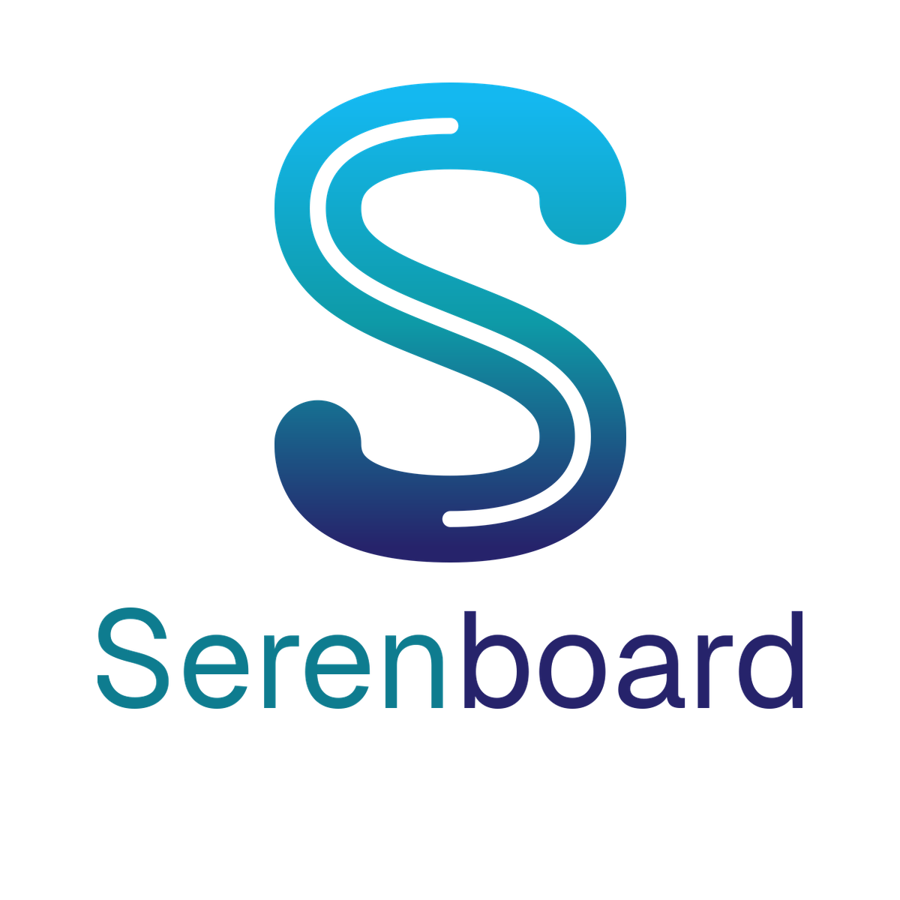

<p align="center">
  <picture>
    <source media="(prefers-color-scheme: dark)" srcset="docs/brand/serenboard-logo-fondo-oscuro.png">
    
  </picture>
</p>

# Serenboard

Tablero Kanban para uso personal y en equipo: tareas, etiquetas jerárquicas, comentarios con hilos, adjuntos, roles por equipo y actualización en tiempo real.

- **Vistas:** tablero (por estado o por etiqueta), lista ordenable y calendario.
- **Acceso:** Google, Microsoft (Outlook), GitHub, passkeys o contraseña. No envía correos. El registro es solo por invitación ([docs/AUTH.md](docs/AUTH.md)).
- **Equipos:** roles admin / product owner / member, invitación por correo de usuario o por enlace caducable.
- **Móvil:** interfaz propia por debajo de 1024 px: navegación inferior, botón flotante, pestañas de estado con deslizamiento, menú "Mover a…" en cada tarjeta, filtros en una hoja y calendario con agenda del día. Objetivos táctiles de 44 px y sin violaciones WCAG 2.2 AA en las pruebas (axe). El escritorio no cambia.
- **Atajos:** `N` nueva tarea · `/` buscar · `1` `2` `3` cambiar de vista.
- **Avisos:** la campana lista las tareas asignadas a ti que vencen en 48 h o ya vencieron. Además, notificaciones push (Web Push) antes del vencimiento, con horas de silencio, y un aviso al asignarte una tarea.
- **PWA:** se puede instalar desde el navegador (móvil y escritorio).
- **App Android nativa:** `native/mobile` (Expo + React Native), con la misma cuenta y el mismo servidor a través de `/api/v1`. Interfaz nativa, no una web dentro de una app. Hay también un APK ligero (TWA) en `native/android`.

**Stack:** Next.js 16 · React 19 · Tailwind 4 · dnd-kit · PostgreSQL 16 + Drizzle ORM · Better Auth (Google, Microsoft, GitHub, passkeys y contraseña; sin correo) · Zod · Vitest + Playwright.

## Arquitectura
Todo corre en una VPS propia: Caddy como puerta de entrada con HTTPS, la app Next.js, PostgreSQL y un volumen para los archivos subidos. No depende de Vercel ni de Supabase. Lo único externo es un Worker de Cloudflare, gratuito, que hace de temporizador para los recordatorios.



1. El navegador resuelve el nombre en DuckDNS y recibe la IP de la VPS.
2. Entra por el puerto 443. Caddy descifra el HTTPS con un certificado de Let's Encrypt que renueva él solo.
3. Caddy pasa la petición por la red interna a Next.js, que comprueba la sesión, valida con Zod y aplica los permisos del rol. La app no es accesible desde internet.
4. La app consulta PostgreSQL (tampoco expuesto) mediante Drizzle. Los adjuntos se guardan en un volumen.
5. Cada cambio se avisa por `LISTEN/NOTIFY` y llega a los navegadores abiertos por SSE, sin recargar.
6. La app Android entra por el mismo Caddy y habla con `/api/v1`, que usa los mismos servicios y permisos que la web. Su sesión es la misma de Better Auth.
7. Cada 5 minutos el Worker de Cloudflare llama a `/api/internal/reminders/tick` (protegido con una clave compartida). El servidor decide qué avisos tocan y los envía por Web Push al servicio de Google, Apple o Mozilla, que los entrega al móvil.

Las imágenes se construyen en local y se suben a la VPS, porque compilar Next.js necesita más memoria de la que tiene el servidor:



El Worker se despliega con `wrangler deploy` desde `workers/reminders` y la app Android se compila con Expo (`native/mobile`). Los logotipos son de [Simple Icons](https://simpleicons.org) y pertenecen a sus titulares. DuckDNS, Better Auth, Playwright, Expo y los servicios de push aparecen como texto porque no figuran en esa colección. La CI de GitHub está en trazo discontinuo porque aún no se usa. Más detalle en [docs/DEPLOY.md](docs/DEPLOY.md).

## Cómo está organizado
```
src/db/schema.ts        Esquema (Drizzle). Las migraciones están en drizzle/
src/lib/permissions.ts  can(): única fuente de verdad de autorización
src/server/services/    Lógica de negocio + permisos (recibe `db`, testeable)
src/server/usecases/    Casos de uso: validación Zod + servicios + efectos (avisos, archivos). Sin transporte
src/server/actions/     Adaptador de la web: server actions (sesión → caso de uso)
src/server/api/         Adaptador HTTP: `endpoint()` para /api/v1 (sesión → caso de uso)
src/app/api/            auth, archivos protegidos, eventos en tiempo real (SSE)
src/app/api/v1/         API HTTP para la app nativa (mismos servicios y permisos)
src/server/push/        Envío de notificaciones (Web Push)
src/types, src/lib/permissions.ts, src/lib/initials.ts   Dominio compartido con la app nativa (`@domain/...`)
workers/reminders/      Worker de Cloudflare: despierta al servidor cada 5 minutos
native/mobile/          App Android (Expo / React Native); native/android es el APK TWA
src/components/         Interfaz
tests/                  Vitest (permisos y servicios contra Postgres en memoria)
e2e/                    Playwright (flujo completo en navegador)
deploy/                 Docker Compose, Caddy y copias de seguridad
```
### Capas del código
La web y la app nativa son dos clientes de las mismas reglas. Cada capa solo conoce a la de debajo:

```
Web (server actions)   App Android (HTTP /api/v1)      ← adaptadores finos: sesión + traducir errores
            \                    /
             usecases/            ← validación (Zod) + orquestación + efectos; reciben `unknown`
                  |
              services/           ← reglas de negocio y permisos (`can()`), reciben `db`
                  |
          PostgreSQL (Drizzle)
```
- Añadir una operación = escribir **un** caso de uso y **dos líneas** en cada adaptador (`actions/*.ts` y la ruta en `app/api/v1`). Las reglas no se repiten.
- La app comparte con la web los tipos y los permisos (`src/types`, `src/lib/permissions.ts`), por lo que no puede desviarse de ellos.
- El cliente de la app (`native/mobile/src/lib/client.ts`) es el único sitio que conoce las rutas HTTP, con los mismos nombres que los casos de uso.

No hay RLS: toda la autorización se aplica en servidor y está cubierta por tests (`tests/services.test.ts`, `tests/api.v1.test.ts`).

## Desarrollo
Requiere Node 22 y Docker.
```bash
docker run -d --name taskzen-pg -p 5433:5432 -e POSTGRES_USER=taskzen -e POSTGRES_PASSWORD=devpass -e POSTGRES_DB=taskzen postgres:16-alpine
cp .env.example .env.local      # rellena BETTER_AUTH_SECRET
npm ci
npm run db:migrate
npm run dev
```
En local, el registro está cerrado: pon `ALLOW_OPEN_SIGNUP=true` en `.env.local` para crear tus primeras cuentas, o usa `BOOTSTRAP_EMAILS` con un proveedor.

## Scripts
| | |
|---|---|
| `npm test` | Tests unitarios y de servicios (no necesitan Docker: usan PGlite) |
| `npm run e2e` | Playwright (necesita Postgres en marcha) |
| `npm run typecheck` · `npm run lint` | Comprobaciones estáticas |
| `npm run db:generate` | Genera una migración tras cambiar `src/db/schema.ts` |
| `npm run db:migrate` | Aplica las migraciones |

## Producción
Ver [docs/DEPLOY.md](docs/DEPLOY.md). Plan y decisiones: [docs/PLAN.md](docs/PLAN.md).

> Esta versión de Next.js tiene cambios incompatibles con versiones anteriores: consulta `node_modules/next/dist/docs/` antes de tocar el framework.
